<p align="center">
  
</p>
<h1 align="center">GiftPool</h1>
<p align="center">
  <b>Plan one gift. Together.</b><br>
  An iOS app for a group of friends buying one gift: invite the group, suggest and vote on ideas,<br>
  split the cost, see who has given, and tick off the checklist until the gift is delivered.
</p>
<p align="center">
  SwiftUI · Firebase Auth · Cloud Firestore · iOS 26 &nbsp;·&nbsp; CSE 3218 mobile app lab project
</p>

<p align="center">
  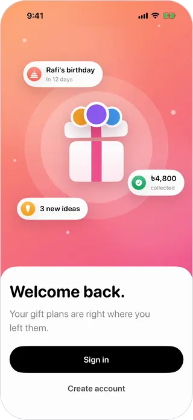
  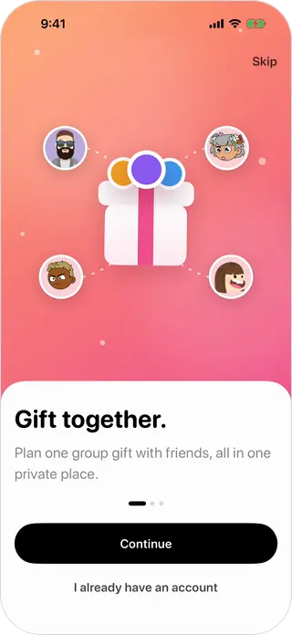
  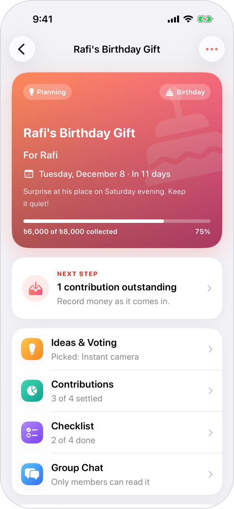
  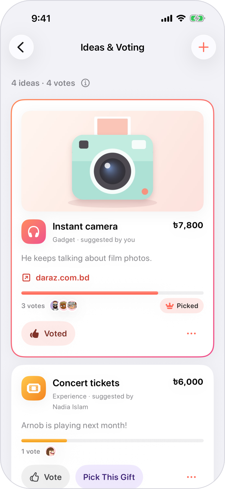
  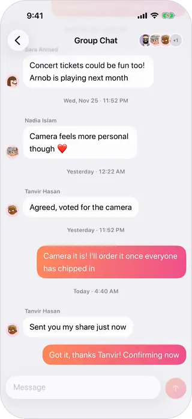
</p>

## Status

All twelve features from the blueprint (F01–F12) work end to end against a live Firebase project. They're checked three ways:

- **44 unit tests** cover the money maths, reminder rules, validation, JSON templates and invite codes.
- **An end-to-end UI test** drives the real app against the Firebase emulator with two fresh accounts: create a plan, ideas and voting, checklist, chat (including editing and unsending a message), invite and join, shares, a reminder, "I have given", confirming, delivery and settings. The screenshots below come from a second UI test.
- **The security rules** were checked with 28 real requests from signed-in users, on the emulator and on the live project: 7 that must be allowed and 21 that must be blocked.

GiftPool never moves money. Friends hand their share to the organizer in person, and the organizer records what arrived.

The organizer does the most work, so the plan page always shows their **next step** with a one-tap button. When the instant camera pulls ahead in the vote, Khalid picks it right there. When Nadia joins late, **Split Equally** gives everyone a fresh share. In the wedding plan, **Remind 5 People** nudges everyone who still owes and wasn't reminded today, in one go. Then **Mark as Purchased** and **Mark as Delivered** finish the plan.

Lock-screen push for reminders is written but not switched on yet; see [Push notifications](#push-notifications). The required in-app reminders work fully: the bell on Home, an unread badge, and mark as read.

## See it in action

<p align="center">
  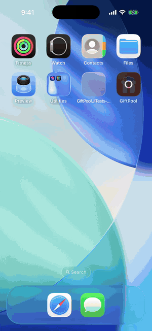
  &nbsp;&nbsp;
  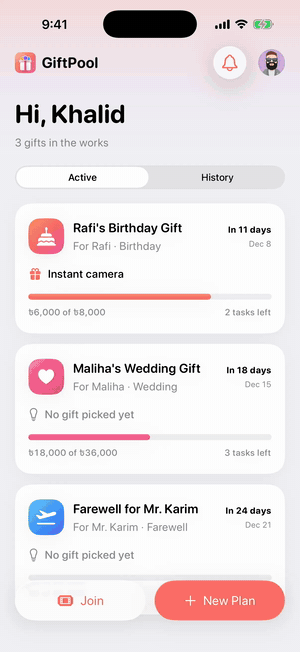
</p>

## Screens

The screenshots use the demo data. **Khalid** is organizing **Rafi's birthday gift** with Nadia, Tanvir and Sara. The group voted for an instant camera, everyone chips in ৳2,000, and Sara has a reminder about her share. A bigger plan, **Maliha's wedding gift**, has twelve people from one office.

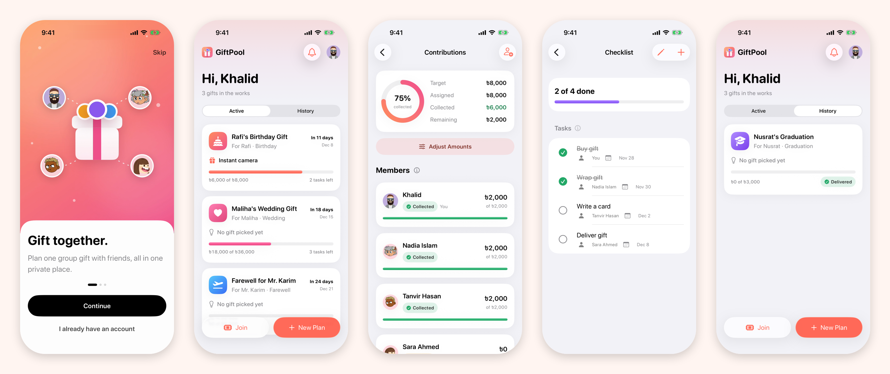

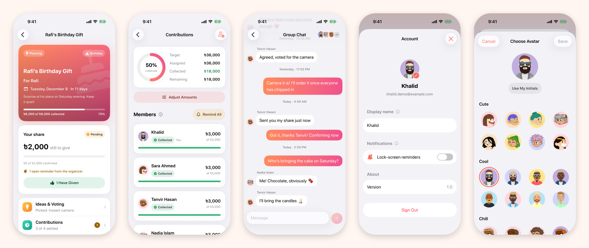

## Features

| | Feature | What it does |
|---|---|---|
| F01 | Accounts | Sign up, sign in, sign out; the session is restored on launch. Pick an avatar from 32 cute, cool, chill and funny faces |
| F02 | Gift plans | Create a plan for a person and occasion with a budget, edit it, delete it |
| F03 | Invitations | A private 16-character code to share; regenerate it or turn it off |
| F04 | Ideas | Members suggest gifts with a price, a photo, a product link, a category and a note |
| F05 | Voting | One vote each, changeable at any time; the organizer picks the winner |
| F06 | Contributions | Split the budget equally in one tap or set shares by hand, then record money as it arrives |
| F07 | "I have given" | A member reports giving; it counts only once the organizer confirms |
| F08 | Private reminders | The organizer nudges one member, or everyone who owes with Remind All; each person at most once every 24 hours |
| F09 | Checklist | Starter tasks from JSON; assign, set due dates, reorder, tick off |
| F10 | Group chat | A live chat per plan, hidden from the gift's recipient, with older messages loaded in pages. Long-press your own message to edit it (for 15 minutes) or unsend it, like Messenger |
| F11 | Status and history | Planning → Purchased → Delivered (or Cancelled); finished plans move to History, read-only |
| F12 | Reminder closure | A reminder shows as resolved once the share is collected, and no new ones can be sent |

## How it fits together

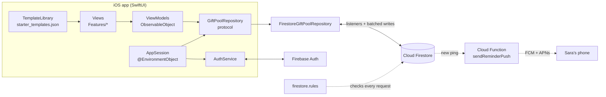

- **Views** only draw state and forward taps.
- **ViewModels** (`HomeViewModel`, `PoolViewModel`, `ChatViewModel`, `RemindersViewModel`…) hold `@Published` state and run the actions. One `PoolViewModel` is shared by every screen of a plan through `@ObservedObject`, so a vote in Ideas updates the plan page straight away.
- **The repository protocol** is the only place that knows about Firestore paths. Each listener feeds its view model live, and `ListenerBag` removes the listeners when a screen goes away.
- **The rules** are the real referee. The app checks things too, for friendly messages, but every important limit is enforced again on the server. For example, only the organizer records money, and reminders are capped at one every 24 hours.

The dotted part on the right is the optional push path, explained under [Push notifications](#push-notifications).

## Data model

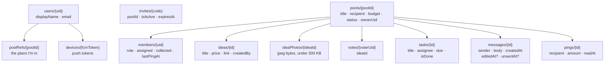

A few choices make the rules simple:

- **Money is stored in paisa, as whole numbers.** Sara's ৳2,000 share is saved as `200000`, so there are no rounding errors.
- **A vote's document ID is the voter's uid.** Sara can only ever hold one vote in Rafi's plan; voting for the concert tickets moves it there.
- **Membership lives in two places.** `pools/{id}/members/{uid}` is what the rules check. `users/{uid}/poolRefs` is how Sara's Home finds Rafi's plan without querying every pool.
- **Idea photos live in their own small documents.** The phone shrinks each photo to about 100 KB first. Keeping photos out of the idea itself means the ideas list stays light, and each card downloads its photo once. (Cloud Storage would be the usual home, but it needs the paid Blaze plan.)
- **Deleting a plan only hides it** (`isDeleted`), because Firestore doesn't delete subcollections, and the history should stay readable anyway.

## A reminder, end to end

Sara still owes her ৳2,000 for Rafi's gift, so Khalid taps **Remind**:

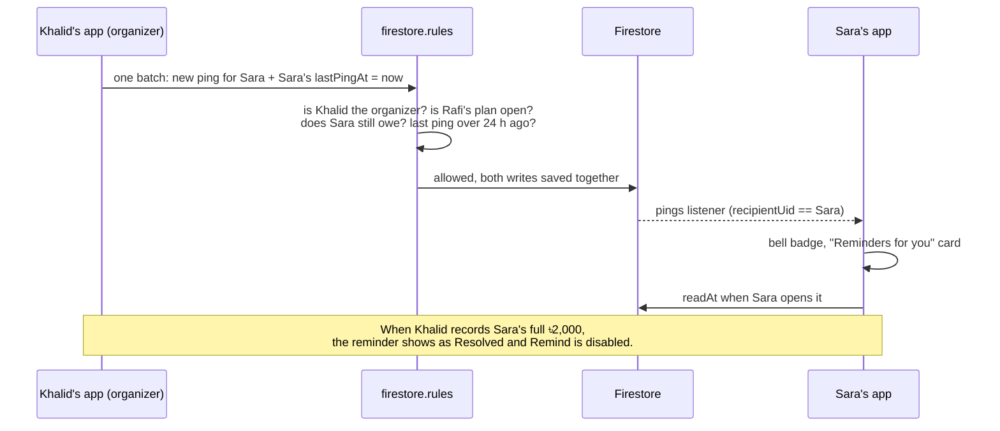

## Repository layout

```text
GiftPool/
├── README.md
├── GiftPool.xcodeproj
├── GiftPool/                       # the app
│   ├── App/                        # entry point, AppSession, RootView, router, push notifications
│   ├── Models/                     # Codable Firestore models and the JSON template types
│   ├── Data/                       # GiftPoolRepository protocol, Firestore implementation, ListenerBag
│   ├── Services/                   # Firebase Auth wrapper, invite codes, JSON template loading
│   ├── Helpers/                    # money maths, reminder rules, validation, dates, error text
│   ├── DesignSystem/               # Theme, buttons, cards, avatars, the gift illustration
│   ├── Features/
│   │   ├── Welcome/                # onboarding and "Welcome back"
│   │   ├── Auth/                   # sign in and create account
│   │   ├── Home/                   # plan list, history, join with a code
│   │   ├── Pool/                   # plan page, editor, invite sheet, next step
│   │   ├── Ideas/                  # ideas and voting
│   │   ├── Members/                # contributions, "I have given", reminders to send
│   │   ├── Checklist/              # tasks
│   │   ├── Chat/                   # group chat
│   │   ├── Reminders/              # reminders I received
│   │   └── Settings/               # account, notifications, sign out
│   └── Resources/starter_templates.json
├── GiftPoolTests/                  # unit tests
├── GiftPoolUITests/                # end-to-end flow and README screenshots
├── firestore.rules · firestore.indexes.json · firebase.json · .firebaserc
└── docs/images/                    # app icon and the screenshots used here
```

## Where things go

| You are adding… | Put it in | Rule |
|---|---|---|
| A new screen | `Features/<area>/` | The view draws; the actions go in its view model |
| An action on a plan | a `PoolViewModel+<Area>.swift` extension | Check the rule in the app first, for a friendly message |
| A Firestore read or write | `GiftPoolRepository` and `FirestoreGiftPoolRepository` | Listeners use `if let error = error` then `compactMap { try? … }` |
| A new limit (who can do what) | `firestore.rules` | The rules are the real check; the app only mirrors them |
| Money or reminder logic | `Helpers/`, with a unit test | Amounts are `Int` paisa, never `Double` |
| A colour, spacing or button | `DesignSystem/` | Use `Theme` values; text colours must pass 4.5:1 contrast |
| An occasion, category or starter task | `Resources/starter_templates.json` | Decoded with `Codable`; no code change needed |

## What the labs taught, and where it's used

| Lab | Topic | Where to look |
|---|---|---|
| Lab 1 | Swift basics: optionals, structs, enums, closures | `Models/`, `Helpers/MoneyCalculator.swift`, `Helpers/Validators.swift` |
| Lab 2 | SwiftUI elements: stacks, `Text`, `Image`, `Button`, `List`, `Form` | every view, e.g. `Features/Home/PoolCardView.swift`, `Features/Pool/PoolEditorView.swift` |
| Lab 3 | `@State`, `@Binding`, `NavigationStack` | `Features/Checklist/TaskRow.swift` (binding), `App/RootView.swift` and `Features/Home/HomeView.swift` (navigation) |
| Lab 4 | Firebase Auth and Firestore, `FirebaseApp.configure()` in `init()`, snapshot listeners, MVVM | `App/GiftPoolApp.swift`, `Services/AuthService.swift`, `Data/FirestoreGiftPoolRepository.swift` |
| Lab 5 | `@StateObject` vs `@ObservedObject` vs `@EnvironmentObject`, JSON parsing with `Codable` | `App/AppSession.swift` (environment), `Features/Pool/PoolDetailView.swift` (state object passed down), `Services/TemplateLoader.swift` |

Beyond the labs: `PhotosPicker` with on-device photo compression, batched writes, server timestamps, Firestore security rules, paging the chat with a cursor, and XCTest with XCUITest.

## Who can do what (`firestore.rules`)

| | Anyone signed in | Member | Organizer |
|---|---|---|---|
| Read a plan, its chat and ideas | no | yes | yes |
| Join | with a valid, active code | | |
| Suggest an idea, vote, chat | | yes, while the plan is open | yes |
| Edit or unsend a chat message | | only their own; edit within 15 minutes | only their own |
| Add or change an idea's photo | | only on their own ideas, under 300 KB | only on their own ideas |
| Record money received | | no | yes, never more than the share |
| Report "I have given" | | for themselves | |
| Send a reminder | | no | once per 24 h, only to someone who still owes |
| Read a reminder | | only their own | yes |
| Edit or close the plan | | no | yes |
| Change a name or avatar | their own | their own | their own |

## Getting started

You need Xcode 26 and the Firebase iOS SDK 13.2, which Swift Package Manager resolves on first open.

1. Open `GiftPool.xcodeproj`. The first package download is large; give it a few minutes.
2. Add your own `GiftPool/GoogleService-Info.plist`. It isn't in the repo: download it from your Firebase project (iOS app, bundle ID `com.excitodevs.GiftPool`) and turn on **Email/Password** sign-in and **Cloud Firestore**. Git ignores the file, so it stays on your machine.
3. Publish the rules:
   ```bash
   npx firebase-tools login
   npx firebase-tools deploy --only firestore:rules,firestore:indexes
   ```
4. Choose an iPhone simulator and press ⌘R.

### Working offline with the emulator

```bash
npx firebase-tools emulators:start --only auth,firestore     # uses firestore.rules
```

Then add `-useEmulator` under **Edit Scheme → Run → Arguments**. Debug builds then talk to the local emulator instead of the live project, so you can create test accounts and plans freely.

## Testing

| What | How |
|---|---|
| Unit tests (44) | ⌘U, or `xcodebuild test -scheme GiftPool -destination 'platform=iOS Simulator,name=iPhone 17 Pro'` |
| End-to-end flow (about 9 min) | Scheme **GiftPoolScreenshots**, test `EndToEndTests`, with the emulator running. It creates its own accounts in the emulator, then does everything else through the app |
| README screenshots | Scheme **GiftPoolScreenshots**, test `ScreenshotTests`, signed in to demo accounts given by `TEST_RUNNER_DEMO_EMAIL`, `TEST_RUNNER_MEMBER_EMAIL` and `TEST_RUNNER_DEMO_PASSWORD`; images go to `TEST_RUNNER_SCREENSHOT_DIR` |

To try it by hand, use two accounts, say Khalid and Sara:

1. Khalid creates "Rafi's Birthday Gift" with a ৳8,000 budget and copies the code from **Invite**.
2. Sara taps **Join** and enters the code.
3. Both suggest ideas, vote and chat. Khalid picks the instant camera and taps **Split Equally**; Sara taps **I Have Given**; Khalid confirms it.
4. Khalid reminds anyone who still owes. They see it under the bell, and it turns Resolved once Khalid records their full share.
5. Khalid marks the plan Purchased, then Delivered. It moves to History for both of them.

## Push notifications

The blueprint makes lock-screen push optional, and says it must come from a trusted server, never from a fake local alert. GiftPool has every piece of that in place:

| Piece | Where | State |
|---|---|---|
| Permission, asked right after you create or join a plan | `App/PushNotifications.swift` | done |
| APNs → FCM token, saved under `users/{uid}/devices` and removed on sign-out | `PushNotifications`, `AppSession` | done |
| Banner while the app is open; tapping a reminder opens that plan's Contributions | `PushNotifications`, `App/RootView.swift` | done |
| Trusted sender: re-checks the organizer, open plan and money owed, sends once, cleans dead tokens | a Cloud Function, kept outside this repo for now | written, not deployed |
| Notifications switch and status | Settings → Notifications | done |

It isn't switched on because two accounts need an upgrade:

1. **A paid Apple Developer Program membership.** Free personal teams can't create the APNs key or sign the Push Notifications capability. Once you have one:
   - make an APNs key (Certificates, IDs & Profiles → Keys) and upload it in Firebase console → Project settings → Cloud Messaging;
   - add the **Push Notifications** capability in Xcode. For now the entitlement is applied to simulator builds only, so device builds keep working on a free team.
2. **The Firebase Blaze plan**, which Cloud Functions require. The free monthly allowance covers a class project. Then add the sender back under `functions/` and run `npx firebase-tools deploy --only functions`.

Why a server at all: a push to someone else's phone must be signed with the project's admin credentials, and those can never ship inside the app. Cloud Functions run Node.js or Python, not Swift, so the sender is the one piece of JavaScript, which is why it stays out of this Swift repo until it's deployed.

Chat and in-app reminders don't depend on any of this.

## References

From the lab handouts:

- [Firebase iOS SDK](https://github.com/firebase/firebase-ios-sdk)
- [Getting started with SwiftUI and Firebase](https://medium.com/@authfy/getting-started-with-swiftui-and-firebase-a-complete-guide-e7c25b7cd9c4)
- [@State vs @Binding](https://blog.devgenius.io/swiftui-state-vs-binding-727262600884)
- [NavigationStack, the modern approach](https://medium.com/@viralswift/mastering-swiftui-navigationstack-the-modernapproach-to-navigation-d0e665f694c5)
- [@ObservedObject, @State and @EnvironmentObject](https://www.hackingwithswift.com/quick-start/swiftui/whats-the-difference-between-observedobject-state-and-environmentobject)
- [@StateObject vs @ObservedObject](https://pedroalvarez-29395.medium.com/swiftui-stateobject-x-observedobject-when-to-use-each-one-f738eb57ba6e)
- [Observable objects and environment objects](https://dev.to/cl0udleadanis/tutorial-13-observable-objects-and-environment-objects-in-swiftui-9o2)
- [Parsing JSON in Swift](https://matteomanferdini.com/swift-parse-json/)
- [Swift: the basics](https://docs.swift.org/swift-book/documentation/the-swift-programming-language/thebasics) and [closures](https://docs.swift.org/swift-book/documentation/the-swift-programming-language/closures/)

Avatar illustrations come from [DiceBear](https://www.dicebear.com) and are used under [CC BY 4.0](https://creativecommons.org/licenses/by/4.0/) (Big Smile by Ashley Seo, Adventurer by Lisa Wischofsky, Fun Emoji by Davis Uche) and the artist's own free-for-commercial-use terms (Avataaars by Pablo Stanley).

Firebase documentation:

- [Cloud Firestore security rules](https://firebase.google.com/docs/firestore/security/get-started)
- [Listen to realtime updates](https://firebase.google.com/docs/firestore/query-data/listen)
- [Batched writes](https://firebase.google.com/docs/firestore/manage-data/transactions)
- [Cloud Messaging on Apple platforms](https://firebase.google.com/docs/cloud-messaging/ios/client)
- [A trusted environment for sending messages](https://firebase.google.com/docs/cloud-messaging/server-environment)
- [Local Emulator Suite](https://firebase.google.com/docs/emulator-suite)

## License

Source-available under the [PolyForm Strict License 1.0.0](https://polyformproject.org/licenses/strict/1.0.0). You may read, build and run GiftPool for personal, noncommercial use, such as studying or grading it. You may not copy it into other projects, publish modified versions or apps, or use it commercially without written permission. See [LICENSE.md](LICENSE.md).
